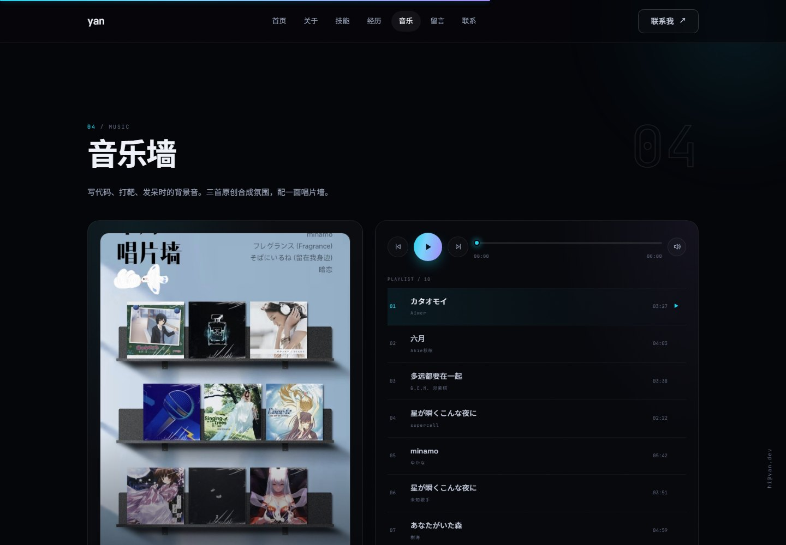
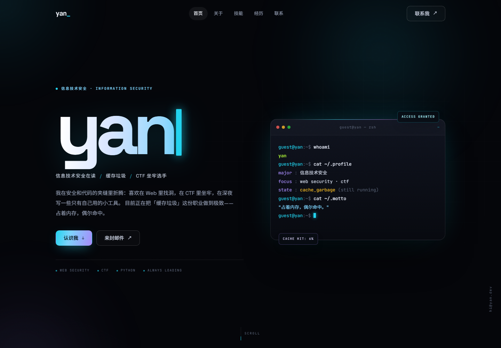
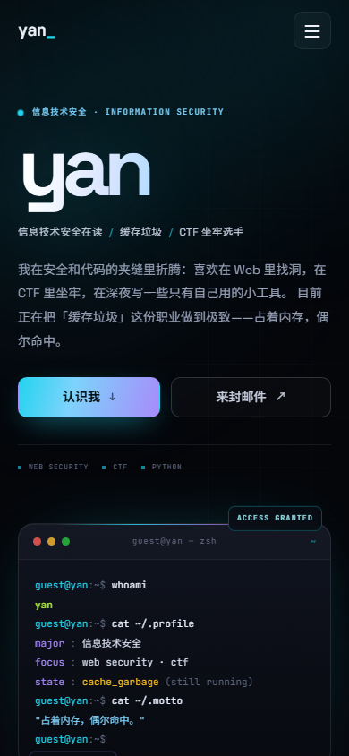

# yan — 个人网站

一个**零依赖、零构建**的深色霓虹个人主页。纯手写 HTML / CSS / JavaScript，打开就能用。

**线上地址**：https://eyeofyan.github.io/  
**仓库**：https://github.com/eyeofyan/eyeofyan.github.io

- 单页结构：首页 Hero / 关于我 / 技能树 / 经历 / 音乐墙 / 留言墙 / 联系方式
- 开场动画：6.2 秒视频 + 开场音乐，跳过按钮、声音开关、同会话只播放一次
- 音乐墙：10 首自选歌曲 + 唱片墙图片，自定义播放器、进度条、循环切歌
- 留言墙：接入 GitHub Issues，访客用 GitHub 登录后留言
- 终端打字机介绍、鼠标光晕、卡片聚光、滚动显现
- 完整响应式：桌面、平板、手机
- 支持键盘导航、`prefers-reduced-motion`、无 JS 降级
- 小彩蛋：在页面任意处键入 `sudo`








---

## 本地打开

直接双击 `index.html` 即可。所有资源都是相对路径，不需要编译或安装依赖。

如果想用本地服务器预览（推荐，字体和路径行为更接近线上）：

```powershell
# 在 personal-site 目录下
python -m http.server 8000
# 然后打开 http://127.0.0.1:8000
```

---

## 文件结构

```
personal-site/
├─ index.html            # 页面结构与全部文案
├─ assets/
│  ├─ styles.css         # 设计变量、布局、动效、响应式
│  ├─ main.js            # 开场动画、播放器、留言墙、导航
│  ├─ favicon.svg        # 站点图标（终端提示符）
│  ├─ music-wall.jpg     # 音乐墙的唱片墙图片
│  ├─ video/
│  │  ├─ intro.mp4       # 开场视频 + 开场音乐（6.2s / 1280×720）
│  │  └─ poster.jpg      # 视频封面
│  └─ audio/
│     └─ *.mp3           # 10 首自选歌曲（约 56MB）
├─ preview/
│  ├─ intro.jpg          # 开场动画截图
│  ├─ music.jpg          # 音乐墙截图
│  ├─ desktop.png        # 桌面端截图
│  └─ mobile.png         # 移动端截图
└─ README.md
```

---

## 必须替换的占位内容

目前的人设文案是围绕「信息技术安全在读 / 缓存垃圾」写的示例，发布前请按实际情况改一遍。

| 内容 | 当前位置 | 说明 |
| --- | --- | --- |
| 邮箱 `3059673932@qq.com` | `index.html` 的 `mailto:`、`data-email`、侧边栏；`main.js` 的兜底值 | 已设置为你的真实邮箱，如需更换请全部替换 |
| GitHub 链接 | `index.html` 底部 `social-row` | 已指向 `github.com/eyeofyan`，源码链接指向当前仓库 |
| 名字 `yan` | 标题、logo、Hero、终端、页脚 | GitHub 用户名是 `eyeofyan`，站内仍使用 `yan`，可自行调整 |
| 学校 / 经历 / 技能 | `index.html` 的 About、Skills、Experience | 已按「广西机电职业技术学院 · 信息技术安全 · 专科在读」填写，如有变化请修改 |
| 缓存命中率 `6%` | `index.html` 中 3 处 `6%` | 彩蛋数字，可改成任意值 |
| 标题与描述 | `index.html` 的 `<title>`、`meta description`、`og:*` | 影响分享卡片与搜索摘要 |

> 联系邮箱已替换为 `3059673932@qq.com`。

---

## 改成你自己的

### 改文案

所有文字都在 `index.html` 里，按注释中的 `HERO` / `ABOUT` / `SKILLS` / `EXPERIENCE` / `CONTACT` 分区查找即可。技能标签、经历卡片、联系方式都是普通 HTML，直接增删。

### 改配色

在 `assets/styles.css` 顶部的 `:root` 里改设计变量：

```css
--bg: #05060a;        /* 页面底色 */
--cyan: #22d3ee;      /* 主霓虹色 */
--violet: #a78bfa;    /* 辅助霓虹色 */
--text: #eef1f8;      /* 主文字 */
--muted: #98a2b8;     /* 次要文字 */
--grad: linear-gradient(105deg, #22d3ee, #7dd3fc, #a78bfa);
```

改 `--cyan` / `--violet` 两个色值，全站的按钮、标签、光晕、终端提示符会一起变化。

### 改终端内容

打开 `assets/main.js`，找到 `terminalScript` 数组：

```js
const terminalScript = [
  { type: "cmd", text: "whoami" },
  { type: "out", html: '<span class="t-name">yan</span>' },
  // ...
];
```

`cmd` 是一行会逐字打出的命令，`out` 是命令输出（可写 HTML），最后 `{ type: "prompt" }` 会留下闪烁光标。改完保存刷新即可。

### 改字体

字体通过 Google Fonts 引入：Space Grotesk（拉丁标题）、JetBrains Mono（等宽）、Noto Sans SC（中文）。离线时会自动回退到系统字体（PingFang / 微软雅黑 / Consolas），不影响使用。

如果不想依赖 Google Fonts，删除 `index.html` 里的三行 `<link>`（preconnect 与 fonts.googleapis.com）即可，站点会完全离线可用。

### 改图标

`assets/favicon.svg` 是一个 `>_` 终端图标，直接编辑 SVG 即可；也可以换成自己的 `.ico` / `.png`，同时修改 `<link rel="icon">`。

### 开场动画

- 视频：`assets/video/intro.mp4`（6.2 秒，1280×720，已做 faststart）
- 开场音乐已经混入视频音轨，右下角「声音 ON」即可听到
- 封面：`assets/video/poster.jpg`
- 首次访问自动播放（静音），约 6 秒后自动进入网站；右上角可跳过
- 同一个浏览器会话只播放一次；想再看一次，访问 `https://eyeofyan.github.io/?intro=1`
- 关闭浏览器标签后重新打开，或换浏览器，会重新播放
- 在 `assets/main.js` 里搜 `yan-intro-seen` 可改这个行为

替换视频时保持 MP4（H.264 / AAC）格式，并同步换掉 `poster.jpg`；竖屏视频不适合这个全屏构图。换开场音乐可以用 ffmpeg 把新音频混进 `intro.mp4`，或直接替换整个视频。

### 音乐墙

左侧是 `assets/music-wall.jpg` 唱片墙，右侧播放器读取 `assets/audio/` 里的 10 首自选歌曲。原始 FLAC 已转成 192kbps MP3（合计约 56MB），浏览器兼容性更好；FLAC 原件保留在本地，不上传。

- 曲目信息在 `assets/main.js` 的 `tracks` 数组里：标题、歌手、文件路径
- 换歌：把音频放进 `assets/audio/`，改 `tracks` 里的 `src` / `title` / `artist`
- 播放器支持：播放暂停、上一首/下一首、拖动进度、静音、自动切下一首
- 默认不自动播放，符合浏览器的自动播放策略
- **版权注意**：这些是商业歌曲，公开部署前请自行确认授权；也可以只保留几首或做试听片段。

### 留言墙

留言墙用 **GitHub Issues** 当后端，不需要服务器、数据库或 Token：

- 访客填写昵称和留言，点击发布后会打开 GitHub 新建 Issue 页面
- 需要用 GitHub 账号登录并提交；Issue 标题以 `[留言]` 开头
- 站点通过 GitHub 公开 API 读取这些 Issue，过滤出 `[留言]`，渲染成留言卡片
- 访客可以点卡片右上角的 `↗` 去 GitHub 回复或点赞
- 如果仓库改名，改 `assets/main.js` 里的 `REPO = "eyeofyan/eyeofyan.github.io"`
- GitHub API 未登录限流约 60 次/小时；站点会缓存 2 分钟，并在失败时显示提示
- 删除 Issue 即可删除对应留言；也可以在 Issue 上回复访客

当前仓库已经开启 Issues，不需要额外安装 App。

---

## 部署

这是纯静态站点，把 `personal-site` 目录里的文件传到任意静态托管即可，无需构建命令。

**GitHub Pages（当前已部署）**

- 线上地址：https://eyeofyan.github.io/
- 仓库：https://github.com/eyeofyan/eyeofyan.github.io
- Pages Source：`main` 分支 / 根目录
- 以后更新：修改本地文件后重新上传，或直接在 GitHub 网页里编辑文件

**Netlify / Vercel / Cloudflare Pages**

- 直接把 `personal-site` 文件夹拖进 Netlify Drop，或导入仓库。
- Build command 留空，Output directory 填 `personal-site`（如果仓库根目录就是站点，则填 `/`）。
- 绑定自定义域名后，记得把 `index.html` 里的邮箱和链接再核对一遍。

---

## 一些实现说明

- **无框架**：没有 React / Vue / 构建工具，全部是浏览器原生能力，部署体积小。
- **动效**：使用 CSS animation / transition 与 IntersectionObserver；`prefers-reduced-motion: reduce` 下会自动关闭动画、开场视频与终端逐字效果。
- **移动端菜单**：打开时锁定页面滚动，`Esc` 关闭，焦点会移入菜单；关闭后回到菜单按钮。
- **复制邮箱**：优先使用 Clipboard API，失败时回退到 `execCommand("copy")`，并给出 toast 提示。
- **音乐**：使用原生 `<audio>` 和自定义 UI，不依赖第三方播放器或音乐平台。
- **留言**：没有自建后端，GitHub Issues 是唯一数据源；站点只做只读展示，提交由 GitHub 完成。
- **隐私**：没有 Cookie、统计脚本或自建追踪；留言会公开显示昵称和 GitHub 用户名。

---

## 可以继续加的东西

- 项目 / 作品集卡片（当前按你的选择没有放）
- 留言墙的点赞数展示、按时间/热度排序
- 文章列表或接入 RSS
- 中英双语切换
- 真正的 PGP 公钥与指纹（安全方向可以加分）
- 接入 Plausible / Umami 之类的隐私友好统计

需要的话，直接在这个页面上继续告诉我就行。
